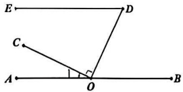

如图，点 $O$ 在直线 $AB$ 上，$OC \perp OD$，$\angle EDO$ 与 $\angle 1$ 互余。

（1）求证：$ED \parallel AB$；

（2）$OF$ 平分 $\angle COD$ 交 $DE$ 于点 $F$，若 $\angle OFD=70^\circ$，补全图形，并求 $\angle 1$ 的度数。

> [!question]- 点击查看答案与解析
> 【答案】（1）证明见解析；（2）$25^\circ$
> 
> 【考点】平行线的判定，角平分线 → [[【初中数学知识点体系-人教版】#7-2 平行线]]
> 
> 【解析】
> （1）证明：
> 因为 $OC \perp OD$，所以 $\angle COD=90^\circ$。
> 因为 $\angle EDO$ 与 $\angle 1$ 互余，所以 $\angle EDO+\angle 1=90^\circ$。
> 又因为 $\angle COD=\angle EDO+\angle 1=90^\circ$，所以 $\angle EDO=\angle 1$。
> 所以 $ED \parallel AB$（内错角相等，两直线平行）。
> 
> （2）因为 $OF$ 平分 $\angle COD$，所以 $\angle COF=\angle DOF=\frac{1}{2}\angle COD=45^\circ$。
> 因为 $ED \parallel AB$，所以 $\angle OFD=\angle FOB=70^\circ$（内错角）。
> 因为 $\angle 1+\angle DOF=\angle OFD$，所以 $\angle 1=70^\circ-45^\circ=25^\circ$。
> 
> 【易错点】要准确利用平行线的性质和角平分线的定义。
