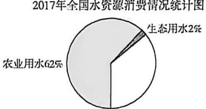
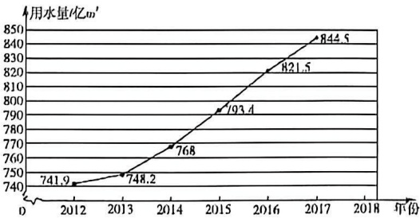

阅读下列材料：

2017年，我国全年水资源总量为 28675 亿 $m^3$。2016年，我国全年水资源总量为 32466.4 亿 $m^3$。2015年，我国全年水资源总量为 27962.6 亿 $m^3$，全年平均降水量为 660.8 mm。

我国水资源的消费结构包含工业用水、农业用水、生态用水、生活用水四类。2017年全国用水总量 6040 亿 $m^3$，其中工业用水占用水总量的 22%，农业用水占用水总量的 62%，生态用水占用水总量的 2%，生活用水 844.5 亿 $m^3$。根据上述材料，解答下列问题：

（1）根据材料画适当的统计图，直观地表示2015～2017年我国全年水资源总量情况；

（2）2017年全国生活用水占用水总量的 ___ %，并补全扇形统计图；

（3）2012～2017年全国生活用水情况统计如下图所示，根据统计图中提供的信息，

$①$ 请你估计2018年全国生活用水量为 ___ 亿 $m^3$，你的预估理由是 ___ 。

$②$ 谈谈节约用水如何从我做起？

2012～2017年全国生活用水量统计图 

> [!question]- 点击查看答案与解析
> 【答案】（1）统计图见解析；（2）$14$；（3）$①$ 约 900 亿 $m^3$，理由见解析；$②$ 答案不唯一
> 
> 【考点】统计图表，数据分析 → [[【初中数学知识点体系-人教版】#12-2 用统计图描述数据]]
> 
> 【解析】
> （1）用折线图或柱状图表示 2015～2017 年我国全年水资源总量情况。
> 
> （2）2017 年全国用水总量 6040 亿 $m^3$，生活用水 844.5 亿 $m^3$。
> 生活用水占比 $=\frac{844.5}{6040} \times 100\% \approx 14\%$。
> 
> （3）$①$ 从统计图看，2012～2017 年生活用水量逐年增加，2017 年约 844.5 亿 $m^3$。
> 估计 2018 年约 900 亿 $m^3$。
> 理由：生活用水量呈逐年增长趋势。
> 
> $②$ 节约用水从我做起：随手关水龙头，一水多用等。
> 
> 【易错点】要准确读取统计图信息，合理进行估算。
