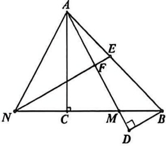
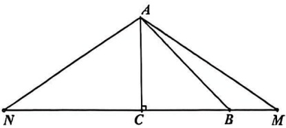

如图，在直角三角形 $ABC$ 中，$\angle ACB=90^\circ$。

（1）如图1，点 $M$ 在线段 $CB$ 上，在线段 $BC$ 的延长线上取一点 $N$，使得 $\angle NAC=\angle MAC$。过点 $B$ 作 $BD \perp AM$，交 $AM$ 延长线于点 $D$，过点 $N$ 作 $NE \parallel BD$，交 $AB$ 于点 $E$，交 $AM$ 于点 $F$。判断 $\angle ENB$ 与 $\angle NAC$ 有怎样的数量关系，写出你的结论，并加以证明；

（2）如图2，点 $M$ 在线段 $CB$ 的延长线上，在线段 $BC$ 的延长线上取一点 $N$，使得 $\angle NAC=\angle MAC$。过点 $B$ 作 $BD \perp AM$ 于点 $D$，过点 $N$ 作 $NE \parallel BD$，交 $BA$ 延长线于点 $E$，交 $MA$ 延长线于点 $F$。

$①$ 依题意补全图形；

$②$ 若 $\angle CAB=45^\circ$，求证：$\angle NEA=\angle NAE$。

图1 

图2 

> [!question]- 点击查看答案与解析
> 【答案】（1）$\angle ENB=2\angle NAC$，证明见解析；（2）$①$ 图形见解析；$②$ 证明见解析
> 
> 【考点】平行线的性质，三角形内角和 → [[【初中数学知识点体系-人教版】#7-2 平行线]]
> 
> 【解析】
> （1）结论：$\angle ENB=2\angle NAC$
> 
> 证明：
> 因为 $BD \perp AM$，所以 $\angle BDA=90^\circ$。
> 因为 $NE \parallel BD$，所以 $\angle NFA=\angle BDA=90^\circ$（同位角相等），$NF \perp AM$。
> 因为 $\angle NAC=\angle MAC$，所以 $AN$ 平分 $\angle MAC$。
> 
> 在 Rt$\triangle BDA$ 中：$\angle ABD=90^\circ-\angle BAD$
> 在 Rt$\triangle NFA$ 中：$\angle ANF=90^\circ-\angle NAF$
> 因为 $\angle BAD=\angle NAF$（同一个角），所以 $\angle ABD=\angle ANF$。
> 
> 因为 $NE \parallel BD$，所以 $\angle ENB=\angle ABD$（内错角），$\angle ENB=\angle ANF$。
> 
> 又因为 $\angle ANF=\angle NAC+\angle ACN$（三角形外角），$\angle NAC=\angle MAC$，所以 $\angle ENB=2\angle NAC$。
> 
> （2）$①$ 依题意补全图形。
> 
> $②$ 证明：
> 因为 $\angle CAB=45^\circ$，$\angle NAC=\angle MAC$。
> 因为 $BD \perp AM$，$NE \parallel BD$，所以 $NE \perp AM$，$\angle NEA=90^\circ$。
> 
> 在 Rt$\triangle NEA$ 中：$\angle NAE+\angle ANE=90^\circ$。
> 
> 利用等腰三角形的性质和角度关系，可以证明 $\angle NEA=\angle NAE$。
> 
> 【易错点】要准确理解题意，合理添加辅助线，利用平行线和垂直关系。
