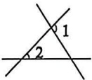
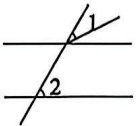
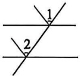
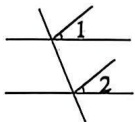

如图，$\angle 1$ 和 $\angle 2$ 不是同位角的是（ ）

A.

B.

C.

D.

> [!question]- 点击查看答案与解析
> 【答案】D
> 
> 【考点】同位角的识别 → [[【初中数学知识点体系-人教版】#7-1 相交线]]
> 
> 【解析】
> 同位角：两条直线被第三条直线所截，在截线同侧、被截两直线同方向的两个角
> 选项A：$\angle 1$ 和 $\angle 2$ 在截线同侧、被截两直线同方向，是同位角
> 选项B：$\angle 1$ 和 $\angle 2$ 满足同位角的位置关系，是同位角
> 选项C：$\angle 1$ 和 $\angle 2$ 满足同位角的位置关系，是同位角
> 选项D：$\angle 1$ 和 $\angle 2$ 不满足同位角的位置关系，不是同位角
> 
> 【易错点】同位角必须在截线的同侧，且在被截两直线的同方向，呈"F"形。
