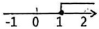
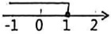
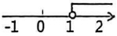
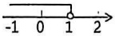

不等式 $x+1\geq 2$ 的解集在数轴上表示正确的是（ ）

A.

B. 

C.

D.

> [!question]- 点击查看答案与解析
> 【答案】B
> 
> 【考点】一元一次不等式的解法，数轴表示 → [[【初中数学知识点体系-人教版】#11-2 一元一次不等式]]
> 
> 【解析】
> 解不等式 $x+1 \geq 2$
> $x \geq 1$
> 在数轴上表示：在 $x=1$ 处画实心圆点（因为含等号），向右画线
> 选项A：空心圆点，错误
> 选项B：实心圆点在 1 处，向右画线，正确
> 选项C：实心圆点在 1 处，向左画线，错误
> 选项D：方向错误
> 
> 【易错点】$\geq$ 用实心圆点，$>$ 用空心圆点；$\geq$ 向右画线。
