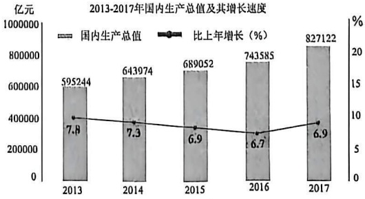

下面的统计图反映了我国2013年到2017年国内生产总值情况。（以上数据摘自国家统计局《中华人民共和国2017年国民经济和社会发展统计公报》）根据统计图提供的信息，下列推断 $\underset{\cdot}{不}\underset{\cdot}{合}\underset{\cdot}{理}$ 的是（ ）

A. 与2016年相比，2017年我国国内生产总值有所增长；

B. 2013-2016年，我国国内生产总值的增长率逐年降低；

C. 2013-2017年，我国国内生产总值的平均增长率约为 6.7%；

D. 2016-2017年比2014-2015年我国国内生产总值增长的多。

> [!question]- 点击查看答案与解析
> 【答案】D
> 
> 【考点】统计图表的分析 → [[【初中数学知识点体系-人教版】#12-2 用统计图描述数据]]
> 
> 【解析】
> 选项A：从统计图看，2017年GDP比2016年有所增长，合理
> 选项B：2013-2016年增长率逐年降低，从图中可以看出，合理
> 选项C：2013-2017年平均增长率约为 6.7%，合理
> 选项D：2016-2017年比2014-2015年增长的多，不合理，因为虽然2016-2017的增长率可能更高，但GDP基数不同，实际增长量需要具体计算，不能直接从增长率推断增长量的大小
> 
> 【易错点】增长率和增长量是不同的概念，增长率大不代表增长量多。
