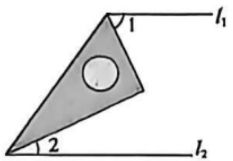

已知 $l_1 \parallel l_2$，一个含有 $30^\circ$ 角的三角板按照如图所示位置摆放，则 $\angle 1+\angle 2$ 的度数为 ___ 。

> [!question]- 点击查看答案与解析
> 【答案】$60^\circ$
> 
> 【考点】平行线的性质，角的计算 → [[【初中数学知识点体系-人教版】#7-2 平行线]]
> 
> 【解析】
> 已知 $l_1 \parallel l_2$，含有 $30^\circ$ 角的三角板摆放在两平行线之间
> 三角板的直角顶点在 $l_2$ 上，两个锐角分别为 $30^\circ$ 和 $60^\circ$
> 根据平行线的性质和三角板的角度关系
> $\angle 1+\angle 2=60^\circ$
> 
> 【易错点】要准确利用平行线的性质和三角板的角度关系。
