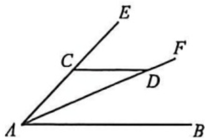

如图，请你添加一个条件，使 $AB \parallel CD$，这个条件是 ___ 。

> [!question]- 点击查看答案与解析
> 【答案】$\angle A=\angle C$（答案不唯一）
> 
> 【考点】平行线的判定 → [[【初中数学知识点体系-人教版】#7-2 平行线]]
> 
> 【解析】
> 要使 $AB \parallel CD$，可以根据平行线的判定定理
> 方法一：同位角相等，可添加 $\angle A=\angle C$
> 方法二：内错角相等，可添加相应的角相等条件
> 方法三：同旁内角互补，可添加相应的角互补条件
> 
> 【易错点】需要根据图形中角的位置关系选择合适的判定方法。
