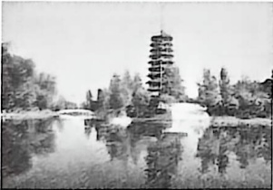
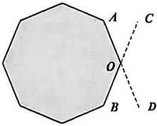

妫川宝塔位于延庆区夏都东湖公园，红墙碧瓦，飞檐翘拱，雕梁画栋，显现了我国古代建筑风格超凡脱俗的光彩，异常雄奇壮观而绚丽华贵。塔内每一层都有壁画，这些壁画具体生动的描绘了妫川大地从古至今动人的历史故事和神话传说，展示了妫川儿女的勤劳与智慧。为了测量塔外墙底部的底角 $\angle AOB$ 的度数，小明同学设计了如下测量方案：作 $AO$，$BO$ 的延长线 $OD$，$OC$，量出 $\angle COD$ 的度数，从而得到 $\angle AOB$ 的度数。这个测量方案的依据是 ___ 。

> [!question]- 点击查看答案与解析
> 【答案】对顶角相等
> 
> 【考点】对顶角的性质 → [[【初中数学知识点体系-人教版】#7-1 相交线]]
> 
> 【解析】
> $AO$ 延长到 $D$，$BO$ 延长到 $C$
> $\angle AOB$ 和 $\angle COD$ 是对顶角
> 根据对顶角相等：$\angle AOB=\angle COD$
> 所以量出 $\angle COD$ 的度数就能得到 $\angle AOB$ 的度数
> 
> 【易错点】对顶角相等的性质要准确运用。
