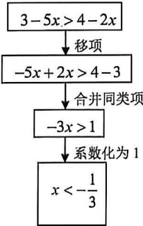

右边的框图表示解不等式 $3-5x>4-2x$ 的流程，其中"系数化为1"这一步骤的依据是 ___ 。

> [!question]- 点击查看答案与解析
> 【答案】不等式的基本性质（不等式两边同除以同一个负数，不等号方向改变）
> 
> 【考点】不等式的基本性质 → [[【初中数学知识点体系-人教版】#11-1 不等式]]
> 
> 【解析】
> 解不等式 $3-5x>4-2x$
> 移项：$-5x+2x>4-3$
> $-3x>1$
> 系数化为 1：$x<-\frac{1}{3}$
> "系数化为 1"是将 $-3x>1$ 两边同除以 $-3$
> 依据是：不等式两边同除以同一个负数，不等号方向改变
> 
> 【易错点】不等式两边同除以负数时，不等号方向要改变。
