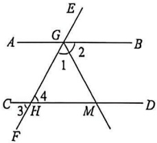

（本题5分）补全解答过程：

已知：如图，直线 $AB \parallel CD$，直线 $EF$ 与直线 $AB$，$CD$ 分别交于点 $G$，$H$；$GM$ 平分 $\angle FGB$，$\angle 3=60^\circ$，求 $\angle 1$ 的度数。

解：$\because EF$ 与 $CD$ 交于点 $H$，（已知）

$\therefore \angle 3=\angle 4$。（ ___ ）

$\because \angle 3=60^\circ$，（已知）

$\therefore \angle 4=60^\circ$。（ ___ ）

$\because AB \parallel CD$，$EF$ 与 $AB$，$CD$ 交于点 $G$，$H$，（已知）

$\therefore \angle 4+\angle FGB=180^\circ$。（ ___ ）

$\therefore \angle FGB=\underline{\quad}$。

$\because GM$ 平分 $\angle FGB$，（已知）

$\therefore \angle 1=\underline{\quad}^\circ$。（角平分线的定义）

> [!question]- 点击查看答案与解析
> 【答案】$\angle 1=60^\circ$
> 
> 【考点】平行线的性质，角平分线 → [[【初中数学知识点体系-人教版】#7-2 平行线]]
> 
> 【解析】
> $\because EF$ 与 $CD$ 交于点 $H$（已知）
> $\therefore \angle 3=\angle 4$（对顶角相等）
> $\because \angle 3=60^\circ$（已知）
> $\therefore \angle 4=60^\circ$（等量代换）
> $\because AB \parallel CD$，$EF$ 与 $AB$，$CD$ 交于点 $G$，$H$（已知）
> $\therefore \angle 4+\angle FGB=180^\circ$（两直线平行，同旁内角互补）
> $\therefore \angle FGB=180^\circ-60^\circ=120^\circ$
> $\because GM$ 平分 $\angle FGB$（已知）
> $\therefore \angle 1=\frac{1}{2} \times 120^\circ=60^\circ$（角平分线的定义）
> 
> 【易错点】要准确识别对顶角、同旁内角的关系，角平分线将角分成两等份。
