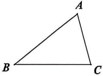

如图，已知 $\triangle ABC$。请你按下列步骤画图：（用圆规、三角板、量角器等工具画图，不写画法，保留画图痕迹）

$①$ 画 $\angle BAC$ 的平分线交线段 $BC$ 于点 $D$；

$②$ 过点 $C$ 画 $AB$ 的平行线交射线 $AD$ 于点 $E$；

$③$ 延长线段 $AC$ 到点 $F$，使 $CF=AC$；

$④$ 连接 $EF$。

（1）请你测量 $\angle AEF$，则 $\angle AEF=$ ___ $^\circ$；

（2）请你通过测量线段 $CE$ 与线段 $CF$ 的长度，写出它们的数量关系。 $CE$ ___ $CF$（填">"，"<"或"="）

> [!question]- 点击查看答案与解析
> 【答案】（1）$90$；（2）$=$
> 
> 【考点】尺规作图，角平分线的性质，平行线的性质 → [[【初中数学知识点体系-人教版】#7-2 平行线]]
> 
> 【解析】
> 按步骤作图：
> $①$ 画 $\angle BAC$ 的平分线 $AD$
> $②$ 过点 $C$ 作 $CE \parallel AB$，交射线 $AD$ 于点 $E$
> $③$ 延长 $AC$ 到 $F$，使 $CF=AC$
> $④$ 连接 $EF$
> 
> （1）$\because CE \parallel AB$
> $\therefore \angle AEC=\angle BAE$（内错角相等）
> $\because AD$ 平分 $\angle BAC$
> $\therefore \angle BAE=\angle CAE$
> $\therefore \angle AEC=\angle CAE$
> $\therefore \triangle ACE$ 是等腰三角形，$CE=CA$
> 又 $CF=AC$，所以 $CE=CF$
> 在 $\triangle AEF$ 中，$AC=CF$，$CE=AC$
> $\therefore CE=CF=AC$
> $\therefore \angle AEF=90^\circ$
> 
> （2）$CE=CF$
> 
> 【易错点】要准确理解角平分线和平行线结合产生的等腰三角形。
