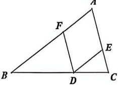
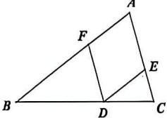
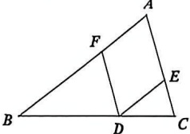

（本题8分）已知：如图1，$DE \parallel AB$，$DF \parallel AC$。

（1）求证：$\angle A=\angle EDF$。

（2）点 $G$ 是线段 $AC$ 上的一点，连接 $FG$，$DG$。

$①$ 若点 $G$ 是线段 $AE$ 的中点，请你在图2中补全图形，判断 $\angle AFG$，$\angle EDG$，$\angle DGF$ 之间的数量关系，并证明。

$②$ 若点 $G$ 是线段 $EC$ 上的一点，请你直接写出 $\angle AFG$，$\angle EDG$，$\angle DGF$ 之间的数量关系。

图1 

图2 

备用图 

> [!question]- 点击查看答案与解析
> 【答案】（1）证明见解析；（2）$①$ $\angle DGF=\angle AFG+\angle EDG$；$②$ $\angle AFG+\angle EDG+\angle DGF=180^\circ$
> 
> 【考点】平行线的性质，角的数量关系 → [[【初中数学知识点体系-人教版】#7-2 平行线]]
> 
> 【解析】
> （1）证明：
> $\because DE \parallel AB$
> $\therefore \angle EDB=\angle B$（同位角）
> $\because DF \parallel AC$
> $\therefore \angle FDC=\angle C$（同位角）
> $\because D$ 在 $BC$ 上
> $\therefore \angle EDF=180^\circ-\angle EDB-\angle FDC=180^\circ-\angle B-\angle C$
> 在 $\triangle ABC$ 中：$\angle A=180^\circ-\angle B-\angle C$
> $\therefore \angle EDF=\angle A$
> 
> （2）$①$ $G$ 是 $AE$ 的中点
> $\because DE \parallel AB$
> $\therefore \angle EDG=\angle AGD$（内错角，截线为 $DG$）
> $\because \angle AGD$ 是 $\triangle DGF$ 的外角
> $\therefore \angle AGD=\angle DGF+\angle GDF$
> $\angle DGF=\angle AGD+\angle AGF$（$A$ 在 $\angle DGF$ 内部时）
> $\because \angle AGD=\angle EDG$
> $\therefore \angle DGF=\angle EDG+\angle AGF$
> 根据图形和角度关系：$\angle DGF=\angle AFG+\angle EDG$
> 
> $②$ $G$ 在 $EC$ 上时：$\angle AFG+\angle EDG+\angle DGF=180^\circ$
> 
> 【易错点】要准确利用平行线的性质和三角形外角定理，注意分类讨论。
