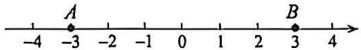

（本题7分）阅读下面材料：

小明在数学课外小组活动时遇到这样一个问题：

如果一个不等式中含有绝对值，并且绝对值符号中含有未知数，我们把这个不等式叫做绝对值不等式，求绝对值不等式 $|x|>3$ 的解集。

小明同学的思路如下：

先根据绝对值的定义，求出 $|x|$ 恰好是 3 时 $x$ 的值，并在数轴上表示为点 $A$，$B$，如图所示。观察数轴发现，以点 $A$，$B$ 为分界点把数轴分为三部分：

点 $A$ 左边的点表示的数的绝对值大于 3；

点 $A$，$B$ 之间的点表示的数的绝对值小于 3；

点 $B$ 右边的点表示的数的绝对值大于3。

因此，小明得出结论绝对值不等式 $|x|>3$ 的解集为：$x<-3$ 或 $x>3$。

参照小明的思路，解决下列问题：

（1）请你直接写出下列绝对值不等式的解集。

$①$ $|x|>1$ 的解集是 ___ 。

$②$ $|x|<2.5$ 的解集是 ___ 。

（2）求绝对值不等式 $2|x-3|+5>13$ 的解集。

（3）直接写出不等式 $x^{2}>4$ 的解集是 ___ 。

> [!question]- 点击查看答案与解析
> 【答案】（1）$①$ $x<-1$ 或 $x>1$；$②$ $-2.5<x<2.5$；（2）$x<-1$ 或 $x>7$；（3）$x<-2$ 或 $x>2$
> 
> 【考点】绝对值不等式的解法 → [[【初中数学知识点体系-人教版】#11-2 一元一次不等式]]
> 
> 【解析】
> （1）$①$ $|x|>1$ 表示到原点的距离大于 1 的点的集合
> 解集为 $x<-1$ 或 $x>1$
> 
> $②$ $|x|<2.5$ 表示到原点的距离小于 2.5 的点的集合
> 解集为 $-2.5<x<2.5$
> 
> （2）$2|x-3|+5>13$
> $2|x-3|>8$
> $|x-3|>4$
> 表示到点 3 的距离大于 4 的点的集合
> $x-3<-4$ 或 $x-3>4$
> $x<-1$ 或 $x>7$
> 解集为 $x<-1$ 或 $x>7$
> 
> （3）$x^2>4$
> $|x|^2>4$
> $|x|>2$
> 解集为 $x<-2$ 或 $x>2$
> 
> 【易错点】$|x-a|>b$ 表示到点 $a$ 的距离大于 $b$ 的点的集合；$x^2>4$ 要转化为 $|x|>2$ 来解。
