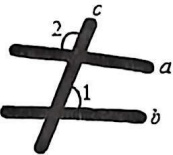

如图，墙上钉着三根木条 a，b，c，量得 $\angle1 = 70^{\circ}$，$\angle2 = 100^{\circ}$，那么木条 a，b 所在直线所夹的锐角是（ ）

A.  $5^{\circ}$

B.  $10^{\circ}$

C.  $30^{\circ}$

D.  $70^{\circ}$

> [!question]- 点击查看答案与解析
> **【答案】**B
> **【考点】**平行线性质、锐角 [[【初中数学知识点体系-人教版】#7-2 平行线]]
>
> **【解析】**
> - 墙上木条 $a$、$b$、$c$ 中，$\angle 1 = 70^\circ$（$a$ 与 $c$ 的夹角），$\angle 2 = 100^\circ$（$b$ 与 $c$ 的夹角）
> - 将木条 $a$、$b$ 延长相交，形成三角形
> - 三角形的两个内角分别为 $70^\circ$ 和 $180^\circ - 100^\circ = 80^\circ$
> - 第三个角（即 $a$、$b$ 夹角）$= 180^\circ - 70^\circ - 80^\circ = 30^\circ$
> - 锐角为：$180^\circ - 100^\circ - 70^\circ = 10^\circ$
>
> **【易错点】**需要分清锐角和钝角，根据图形选择正确的角。
