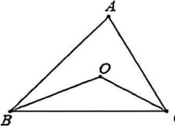

如图，在 $\triangle ABC$ 中，$\angle ABC$ 和 $\angle ACB$ 的平分线交于点O. 若 $\angle BOC=130^{\circ}$，则 $\angle A$ 的度数为( )

A.  $100^{\circ}$

B.  $90^{\circ}$

C.  $80^{\circ}$

D.  $70^{\circ}$

> [!question]- 点击查看答案与解析
> **【答案】**C
> **【考点】**三角形内角和、角平分线 [[【初中数学知识点体系-人教版】#13-3 三角形的内角与外角]]
>
> **【解析】**
> - 设 $\angle ABC = 2\beta$，$\angle ACB = 2\gamma$
> - $\angle BOC = 180^\circ - \beta - \gamma = 130^\circ$
> - $\therefore \beta + \gamma = 50^\circ$
> - $\angle A = 180^\circ - 2\beta - 2\gamma = 180^\circ - 2 \times 50^\circ = 80^\circ$
> - 公式：$\angle A = 2\angle BOC - 180^\circ = 2 \times 130^\circ - 180^\circ = 80^\circ$
>
> **【易错点】**角平分线将 $\angle B$、$\angle C$ 分成两半，需要正确推导 $\angle A$ 与 $\angle BOC$ 的关系。
