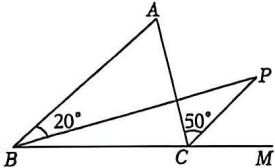

如图，BP 是 $\triangle ABC$ 中 $\angle ABC$ 的平分线，CP 是 $\angle ACB$ 的外角的平分线，如果 $\angle ABP = 20^\circ$，$\angle ACP = 50^\circ$，则 $\angle P =$（ ）

A. $20^\circ$

B. $30^\circ$

C. $35^\circ$

D. $40^\circ$

> [!question]- 点击查看答案与解析
> **【答案】**B
> **【考点】**角平分线、内外角平分线夹角 [[【初中数学知识点体系-人教版】#13-3 三角形的内角与外角]]
>
> **【解析】**
> - $BP$ 平分 $\angle ABC$，$\therefore \angle PBC = \angle ABP = 20^\circ$
> - $CP$ 平分 $\angle ACB$ 的外角，$\therefore \angle ACP = 50^\circ$（外角的一半）
> - 由 $\triangle BPC$ 中外角性质：$\angle ACP = \angle PBC + \angle P$
> - $50^\circ = 20^\circ + \angle P$
> - $\angle P = 30^\circ$
>
> **【易错点】**注意 $CP$ 是 $\angle ACB$ 的外角的平分线，不是 $\angle ACB$ 本身的平分线。
