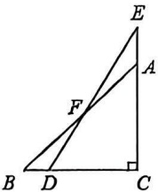

如图，一副分别含有 $30^{\circ}$ 和 $45^{\circ}$ 角的两个直角三角板，拼成如图所示，其中 $\angle C = 90^{\circ}$，$\angle B = 45^{\circ}$，$\angle E = 30^{\circ}$，则 $\angle BFD$ 的度数是( )

A.  $10^{\circ}$

B.  $15^{\circ}$

C.  $25^{\circ}$

D.  $30^{\circ}$

> [!question]- 点击查看答案与解析
> **【答案】**B
> **【考点】**三角板角度、外角性质 [[【初中数学知识点体系-人教版】#6-3 角]]
>
> **【解析】**
> - 由题意，$\triangle ABC$ 中 $\angle C = 90^\circ$，$\angle B = 45^\circ$，$\therefore \angle A = 45^\circ$
> - $\triangle DEF$ 中 $\angle EDF = 90^\circ$，$\angle E = 30^\circ$，$\therefore \angle DFE = 60^\circ$
> - 设 $DE$ 与 $AB$ 交于点 $G$，$DF$ 与 $AB$ 交于点 $F$（即点 $F$ 在 $AB$ 上）
> - 利用三角形外角性质：$\angle BFD$ 是 $\triangle AFG$ 的外角
> - 或更直接：$\angle EDC = 90^\circ - \angle E = 90^\circ - 30^\circ = 60^\circ$
> - 在 $\triangle BFD$ 中，$\angle BDF = 180^\circ - \angle EDC = 180^\circ - 60^\circ = 120^\circ$
> - $\therefore \angle BFD = 180^\circ - \angle B - \angle BDF = 180^\circ - 45^\circ - 120^\circ = 15^\circ$
> - 另一种方法（外角）：$\angle BFD = \angle EDC - \angle B = 60^\circ - 45^\circ = 15^\circ$
>
> **选项分析：**
> - 选项A（$10^\circ$）：计算错误，角度关系理解有误
> - 选项B（$15^\circ$）：正确，利用外角性质 $\angle BFD = \angle EDC - \angle B = 60^\circ - 45^\circ = 15^\circ$
> - 选项C（$25^\circ$）：角度差值计算错误
> - 选项D（$30^\circ$）：误将 $\angle E$ 直接当作答案
>
> **【易错点】**需要准确识别两个三角板的拼接方式，正确运用外角性质。
