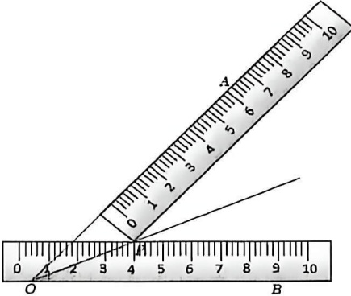

小红同学在学习了全等三角形相关知识后发现，只用两把完全相同的长方形直尺就可以作出一个角的平分线。如图，一把直尺压住射线 OB，另一把直尺压住射线 OA 并且与第一把直尺交于点 P，小红说："射线 OP 就是  $\angle BOA$ 的平分线"。她这样做的依据是( )

A. 角的内部到角的两边距离相等的点在角的平分线上

B．角平分线上的点到这个角两边的距离相等

C．三角形三条角平分线的交点到三条边的距离相等

D．角平分线把角分成相等的两部分

> [!question]- 点击查看答案与解析
> **【答案】**A
> **【考点】**角平分线判定 [[【初中数学知识点体系-人教版】#13-3 三角形的内角与外角]]
>
> **【解析】**
> - 两把完全相同的长方形直尺分别压住 $OB$、$OA$
> - 交点 $P$ 到 $OA$ 的距离 = 交点 $P$ 到 $OB$ 的距离（直尺宽度相等）
> - 由角平分线判定：角的内部到角的两边距离相等的点在角的平分线上
> - $\therefore$ 射线 $OP$ 是 $\angle BOA$ 的平分线
>
> **【易错点】**B 是"角平分线上的点到这个角两边的距离相等"（性质定理，不是判定依据），C 是内心定理，D 只是角平分线定义。
