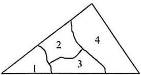

如图，一块三角形玻璃碎成了四块，现在要到玻璃店去配一块与原来的三角形玻璃完全一样的玻璃，那么最省事的办法是带第几块玻璃（ ）

A. 1

B. 2

C. 3

D. 4

> [!question]- 点击查看答案与解析
> **【答案】**B
> **【考点】**全等三角形判定 [[【初中数学知识点体系-人教版】#14-2 三角形全等的判定]]
>
> **【解析】**
> - 玻璃碎成 4 块，要配与原三角形完全一样的玻璃
> - 带第 2 块（第 2 块含有两个角和夹边）
> - 用 ASA 判定：两角及其夹边对应相等的两个三角形全等
>
> **【易错点】**AAS、SAS、ASA 的区别：ASA 是两角夹一边，AAS 是两角及一角的对边。
