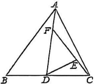

如图，$\triangle ABC$ 的面积是 1，$AD$ 是 $\triangle ABC$ 的中线，$AF=\frac{1}{2}FD$，$CE=\frac{1}{2}EF$，则 $\triangle DEF$ 的面积为 ( )

A. $\frac{1}{2}$  

B. $\frac{3}{4}$  

C. $\frac{8}{27}$  

D. $\frac{2}{9}$

> [!question]- 点击查看答案与解析
> **【答案】**D
> **【考点】**中线、三角形面积 [[【初中数学知识点体系-人教版】#13-2 与三角形有关的线段]]
>
> **【解析】**
> $S_{\triangle ABC} = 1$。
> $AD$ 是 $\triangle ABC$ 的中线，$\therefore S_{\triangle ABD} = S_{\triangle ACD} = \frac{1}{2}$，$BD = DC$。
> $AF = \frac{1}{2}FD$，即 $AF:FD = 1:2$，$\therefore AF:AD = 1:3$，$FD:AD = 2:3$。
> $CE = \frac{1}{2}EF$，即 $CE:EF = 1:2$，$\therefore CE:CF = 1:3$，$EF:CF = 2:3$。
> $S_{\triangle CDF} = \frac{FD}{AD} \times S_{\triangle ACD} = \frac{2}{3} \times \frac{1}{2} = \frac{1}{3}$。
> $S_{\triangle DEF} = \frac{EF}{CF} \times S_{\triangle CDF} = \frac{2}{3} \times \frac{1}{3} = \frac{2}{9}$。
>
> **【易错点】**需要正确利用线段比计算面积比，注意 $F$ 在 $AD$ 上、$E$ 在 $CF$ 上的位置关系。
