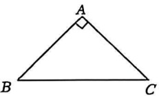
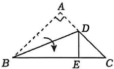
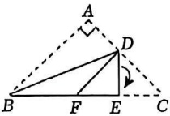

在 $\triangle ABC$中，$\angle A=90^\circ$，$AB=AC$，将 $\triangle ABC$ 按如图所示的方式依次折叠：有下面四个结论：

$①$ DE 平分 $\angle FDC$；$②$ $BF = AD$；$③$ $\angle ADB = 3\angle BDF$；$④$ $\triangle FED$ 的周长等于 BC 的长。所有正确结论的序号为( )

A. $①③$

B. $①③④$

C. $②③④$

D. $①②③④$

> [!question]- 点击查看答案与解析
> **【答案】**D
> **【考点】**翻折变换、全等三角形 [[【初中数学知识点体系-人教版】#14-1 全等三角形及其性质]]
>
> **【解析】**
> - $\triangle ABC$ 中 $\angle A = 90^\circ$，$AB = AC$，是等腰直角三角形
> - 折叠后 $DE$ 平分 $\angle FDC$（由折叠对称性）
> - $BF = AD$（由折叠对应边相等）
> - $\angle ADB = 3\angle BDF$（由折叠角度关系）
> - $\triangle FED$ 周长 = $FE + ED + DF = AF + AD + DC = AC + AD = BC$
> - 所有 4 个结论都正确，选 D
>
> **【易错点】**折叠后 $BF = AD$ 是关键结论，需要通过全等三角形证明。
