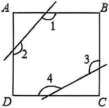

如图，正方形  $ABCD$ 中，截去 $\angle A$，$\angle C$ 后，$\angle 1$，$\angle 2$，$\angle 3$，$\angle 4$ 的和为 ___ 。

> [!question]- 点击查看答案与解析
> **【答案】**$180^\circ$
> **【考点】**正方形内角和、截角问题 [[【初中数学知识点体系-人教版】#13-3 三角形的内角与外角]]
>
> **【解析】**
> - 正方形 $ABCD$ 中，$\angle A = \angle B = \angle C = \angle D = 90^\circ$
> - 截去 $\angle A$：截线在 $\angle A$ 处形成一个三角形，该三角形的三个内角为 $\angle 1$、$\angle 2$、$\angle A$
> - $\angle 1 + \angle 2 + \angle A = 180^\circ$（三角形内角和）
> - $\angle 1 + \angle 2 = 180^\circ - 90^\circ = 90^\circ$
> - 同理，截去 $\angle C$：$\angle 3 + \angle 4 + \angle C = 180^\circ$
> - $\angle 3 + \angle 4 = 180^\circ - 90^\circ = 90^\circ$
> - $\therefore \angle 1 + \angle 2 + \angle 3 + \angle 4 = 90^\circ + 90^\circ = 180^\circ$
>
> **【易错点】**截角处在截线同侧形成三角形，利用三角形内角和求解。
