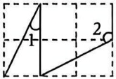

如图所示的网格为正方形网格，则 $\angle2 - \angle1 =$ ___ °.

> [!question]- 点击查看答案与解析
> **【答案】**$90^\circ$
> **【考点】**正方形网格角度、全等三角形 [[【初中数学知识点体系-人教版】#14-1 全等三角形及其性质]]
>
> **【解析】**
> - 设每个小正方形的边长为 $1$，将 $\angle 1$ 所在的直角三角形沿水平方向平移，使 $\angle 1$ 的一条直角边与 $\angle 2$ 的一条直角边重合
> - 构造辅助线：连接 $\angle 1$ 和 $\angle 2$ 的顶点，形成一个新的三角形
> - 利用 SSS 证明两三角形全等：两个直角三角形的直角边分别为 $1$、$2$ 和 $2$、$1$，斜边均为 $\sqrt{5}$
> - 由全等三角形对应角相等，结合位置关系可知 $\angle 2 - \angle 1 = 90^\circ$
>
> **另一种推导方法：**
> - 设小正方形边长为 $1$，$\tan\angle 1 = \frac{1}{2}$，$\tan\angle 2 = 2$
> - 注意：$\tan\angle 1 \cdot \tan\angle 2 = 1$ 只能说明两角互余（即 $\angle 1 + \angle 2 = 90^\circ$），不能直接推出差为 $90^\circ$
> - 正确推导需结合网格图中两角的具体位置：将 $\angle 1$ 所在三角形平移后，$\angle 2$ 与 $\angle 1$ 的余角构成直角关系
> - 通过构造全等直角三角形，可证 $\angle 2 - \angle 1 = 90^\circ$
>
> **【易错点】**不能由 $\angle 1 + \angle 2 = 90^\circ$ 直接推出 $\angle 2 - \angle 1 = 90^\circ$，需结合网格图用全等三角形证明。
