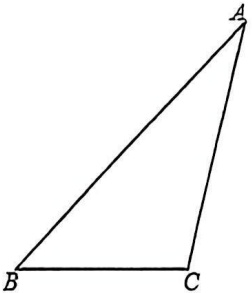

已知：如图，$\triangle ABC$.

（1）画出 $\Delta ABC$ 中 BC 边上的中线 AD；

（2）画出 $\Delta ADC$ 中 AC 边上的高线 DE；

（3）画出 $\angle B$ 的角平分线 BM；

（4）比较 $\angle BMC$ 与 $\angle BAC$ 的大小：$\angle BMC$ ___  $\angle BAC$，依据是 ___ .

（5）比较线段 CD 与 DE 的大小：CD ___ DE，依据是 ___ .

> [!question]- 点击查看答案与解析
> **【答案】**(1) 中线 $AD$；(2) 高 $DE$；(3) 角平分线 $BM$；(4) $>$，三角形的外角大于不相邻的内角；(5) $>$，垂线段最短
> **【考点】**中线、高、角平分线、外角、垂线段 [[【初中数学知识点体系-人教版】#13-2 与三角形有关的线段]]
>
> **【解析】**
> (1) 取 $BC$ 中点 $D$，连接 $AD$ 即为中线。
> (2) 过 $D$ 作 $AC$ 的垂线，垂足为 $E$，$DE$ 即为 $\triangle ADC$ 中 $AC$ 边上的高。
> (3) 以 $B$ 为顶点作 $\angle B$ 的平分线 $BM$。
> (4) $BM$ 是角平分线，$\angle BMC$ 是 $\triangle ABM$ 的外角，$\therefore \angle BMC = \angle BAM + \angle ABM > \angle BAC$。
> (5) $DE \perp AC$ 于 $E$，$D$ 到 $AC$ 的距离是 $DE$；$D$ 到 $C$ 的距离是 $CD$（斜边）；$\therefore CD > DE$。
>
> **【易错点】**垂线段最短：点到直线的垂线段是所有连线中最短的。
