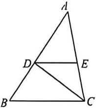

如图，在三角形 $ABC$ 中，$CD$ 平分 $\angle ACB$，$DE // BC$，$\angle AED = 80^\circ$，求 $\angle EDC$ 的度数.

> [!question]- 点击查看答案与解析
> **【答案】**$40^\circ$
> **【考点】**角平分线、平行线性质 [[【初中数学知识点体系-人教版】#7-2 平行线]]
>
> **【解析】**
> - $CD$ 平分 $\angle ACB$
> - $DE \parallel BC$
> - $\angle AED = 80^\circ$
> - $\because DE \parallel BC$，$\therefore \angle ACB = \angle AED = 80^\circ$（两直线平行，同位角相等）
> - $CD$ 平分 $\angle ACB$，$\therefore \angle DCB = \frac{1}{2}\angle ACB = 40^\circ$
> - $DE \parallel BC$，$\therefore \angle EDC = \angle DCB = 40^\circ$（内错角相等）
>
> **【易错点】**$DE \parallel BC$ 时，$\angle AED$ 与 $\angle ACB$ 是同位角，$\angle EDC$ 与 $\angle DCB$ 是内错角。
