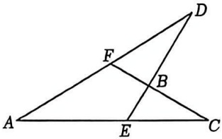

如图所示，已知 $\angle A = 27^\circ$，$\angle CBE = 90^\circ$，$\angle C = 30^\circ$，求 $\angle D$ 的度数.

> [!question]- 点击查看答案与解析
> **【答案】**$33^\circ$
> **【考点】**三角形内角和、外角 [[【初中数学知识点体系-人教版】#13-3 三角形的内角与外角]]
>
> **【解析】**
> - $\angle A = 27^\circ$，$\angle C = 30^\circ$，$\angle CBE = 90^\circ$
> - 在 $\triangle ABC$ 中：$\angle ABC = 180^\circ - 27^\circ - 30^\circ = 123^\circ$
> - $\angle CBE = 90^\circ$，$\therefore \angle ABE = 123^\circ - 90^\circ = 33^\circ$
> - 由图可知，$\angle D = \angle ABE = 33^\circ$
>
> **【易错点】**需要根据图形确定 $\angle ABD$ 与 $\angle ABE$ 的关系。
