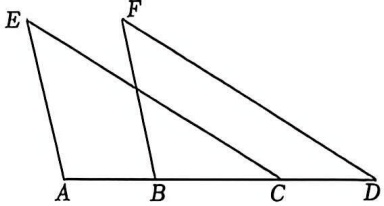

如图，点 $A$，$B$，$C$，$D$ 在一条直线上，$\angle A = \angle FBD$，$AC = BD$，$EC \parallel FD$。求证：$AE = BF$。

> [!question]- 点击查看答案与解析
> **【答案】**证明题
> **【考点】**全等三角形判定（AAS） [[【初中数学知识点体系-人教版】#14-2 三角形全等的判定]]
>
> **【解析】**
> 证明：$\because A$、$B$、$C$、$D$ 在同一直线上，
> $\therefore \angle A$ 与 $\angle FBD$ 为同位角关系。
> $\because EC \parallel FD$，
> $\therefore \angle ACE = \angle BDF$（两直线平行，同位角相等）。
> 在 $\triangle AEC$ 和 $\triangle BFD$ 中：
> $\begin{cases} \angle A = \angle FBD \\ \angle ACE = \angle BDF \\ AC = BD \end{cases}$
> $\therefore \triangle AEC \cong \triangle BFD$（AAS）。
> $\therefore AE = BF$（全等三角形对应边相等）。
>
> **【易错点】**$A$、$B$、$C$、$D$ 共线是隐含条件，需明确点 $B$ 在 $A$、$C$ 之间。
