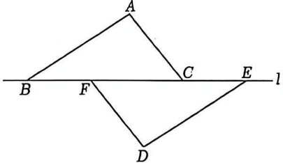

如图，点 $B$，$F$，$C$，$E$ 在直线 $l$ 上 ( $F$，$C$ 之间不能直接测量)，点 $A$，$D$ 在 $l$ 异侧，测得 $AB = DE$，$AB \parallel DE$，$\angle A = \angle D$。求证：$BF = CE$。

> [!question]- 点击查看答案与解析
> **【答案】**证明题
> **【考点】**全等三角形判定（AAS）、平行线 [[【初中数学知识点体系-人教版】#14-2 三角形全等的判定]]
>
> **【解析】**
> 证明：$\because AB \parallel DE$（已知），
> $\therefore \angle ABF = \angle DEC$（两直线平行，同位角相等）。
> $\because \angle A = \angle D$（已知），
> $AB = DE$（已知），
> 在 $\triangle ABF$ 和 $\triangle DEC$ 中：
> $\begin{cases} \angle A = \angle D \\ AB = DE \\ \angle ABF = \angle DEC \end{cases}$
> $\therefore \triangle ABF \cong \triangle DEC$（ASA）。
> $\therefore BF = EC$（全等三角形对应边相等）。
>
> **【易错点】**$BF = CE$ 的证明关键是 $\triangle ABF \cong \triangle DEC$。
