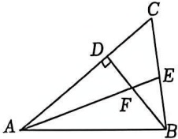

如图，在 $\triangle ABC$ 中，$\angle ABC=82^\circ$，$\angle C=58^\circ$，$BD \perp AC$ 于 $D$，$AE$ 平分 $\angle CAB$，$BD$ 与 $AE$ 交于点 $F$，求 $\angle AFB$。

> [!question]- 点击查看答案与解析
> **【答案】**$110^\circ$
> **【考点】**三角形内角和、角平分线、高 [[【初中数学知识点体系-人教版】#13-3 三角形的内角与外角]]
>
> **【解析】**
> - $\angle ABC = 82^\circ$，$\angle C = 58^\circ$
> - $\angle BAC = 180^\circ - 82^\circ - 58^\circ = 40^\circ$
> - $AE$ 平分 $\angle CAB$，$\therefore \angle BAE = \angle CAE = 20^\circ$
> - $BD \perp AC$，$\therefore \angle BDA = 90^\circ$（$D$ 在 $AC$ 上）
> - 在 $\triangle ABD$ 中：$\angle ABD = 180^\circ - 90^\circ - 40^\circ = 50^\circ$
> - $F$ 是 $AE$ 与 $BD$ 的交点
> - 在 $\triangle ABF$ 中：
>   - $\angle BAF = \angle BAE = 20^\circ$
>   - $\angle ABF = \angle ABD = 50^\circ$
>   - $\angle AFB = 180^\circ - 20^\circ - 50^\circ = 110^\circ$
>
> **【易错点】**需要正确识别 $F$ 点是两条线的交点，在 $\triangle ABF$ 中应用三角形内角和。
