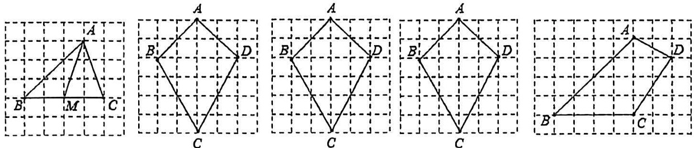

如图，我们知道在 $\triangle ABC$ 中，中线 $AM$ 可以将 $\triangle ABC$ 分成两个面积相等的三角形，即 $S_{\triangle ABM}=S_{\triangle ACM}$。

（1）参考上述结论，请尝试使用两种不同的方法将图中的四边形 $ABCD$ 分成 4 个面积相等的小三角形：

（2）请在四边形 $ABCD$ 的边上找到一点 E，使得线段 AE 将四边形 $ABCD$ 分为面积相等的两部分.

> [!question]- 点击查看答案与解析
> **【答案】**(1) 见解析；(2) $E$ 为 $BD$ 的中点
> **【考点】**面积四等分、面积平分 [[【初中数学知识点体系-人教版】#13-2 与三角形有关的线段]]
>
> **【解析】**
> (1) 方法一：连接对角线 $AC$ 和 $BD$，交于点 $O$，连接 $OA$、$OB$、$OC$、$OD$，将四边形分成 4 个面积相等的三角形。
> 方法二：分别取 $AB$、$BC$、$CD$、$DA$ 的中点，相邻中点与对角顶点相连，分成 4 个面积相等的三角形。
>
> (2) 取 $BD$ 的中点 $E$，连接 $AE$。
> $\because E$ 是 $BD$ 的中点，
> $\therefore S_{\triangle ABE} = S_{\triangle ADE} = \frac{1}{2} S_{\triangle ABD}$。
> 又 $\because S_{\triangle BCD} = S_{\triangle ABD}$（等底等高），
> $\therefore S_{\triangle ABE} + S_{\triangle ADE} = \frac{1}{2} S_{四边形ABCD}$。
> 即 $AE$ 将四边形 $ABCD$ 分为面积相等的两部分。
>
> **【易错点】**(2) 的关键是找到 $E$ 使得 $S_{\triangle ABE} = S_{\triangle AED}$，即 $BE = ED$。
