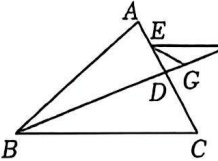
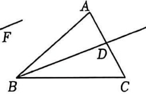
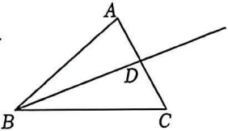

在 $\triangle ABC$ 中，$BD$ 平分 $\angle ABC$ 交 $AC$ 于点 $D$，点 $E$ 是射线 $AC$ 上的动点（不与点 $D$ 重合），过点 $E$ 作 $EF//BC$ 交直线 $BD$ 于点 $F$，$\angle CEF$ 的角平分线所在直线与射线 $BD$ 交于点 $G$。

（1）如图1，点 E 在线段 AD 上运动.

$①$ 若 $\angle ABC = 40^\circ$，$\angle C = 60^\circ$，则 $\angle BGE =$ ___ °；

$②$ 若 $\angle A = 70^\circ$，则 $\angle BGE =$ ___ ；

$③$ 探究 $\angle BGE$ 与 $\angle A$ 之间的数量关系，并说明理由；

（2）若点 E 在射线 DC 上运动时，$\angle BGE$ 与 $\angle A$ 之间的数量关系与（1）$③$ 中的数量关系是否相同？若不同，请写出它们之间的数量关系并说明理由.

图1 

备用图 

备用图 

> [!question]- 点击查看答案与解析
> **【答案】**(1) $①$ $30^\circ$；$②$ $55^\circ$；$③$ $\angle BGE = 90^\circ - \frac{1}{2}\angle A$；(2) 不同，$\angle BGE = \frac{1}{2}\angle A$
> **【考点】**平行线、角平分线、综合应用 [[【初中数学知识点体系-人教版】#7-2 平行线]]
>
> **【解析】**
> (1) 当点 $E$ 在线段 $AD$ 上运动时：
>
> $①$ $\angle ABC = 40^\circ$，$\angle C = 60^\circ$，$\angle A = 80^\circ$。
> $\because BD$ 平分 $\angle ABC$，$\therefore \angle DBC = 20^\circ$。
> $\because EF \parallel BC$，$\therefore \angle AEF = \angle C = 60^\circ$（同位角相等），
> $\therefore \angle CEF = 180^\circ - 60^\circ = 120^\circ$。
> $\because EG$ 平分 $\angle CEF$，$\therefore \angle GEC = 60^\circ$。
> 结合图形，由角度关系可得 $\angle BGE = 30^\circ$。
>
> $②$ $\angle A = 70^\circ$，同理可得 $\angle BGE = 55^\circ$。
>
> $③$ 探究 $\angle BGE$ 与 $\angle A$ 的数量关系：$\boxed{\angle BGE = 90^\circ - \frac{1}{2}\angle A}$。
>
> 证明：设 $\angle ABC = 2\alpha$，$\angle C = \beta$，则 $\angle A = 180^\circ - 2\alpha - \beta$。
> $\because BD$ 平分 $\angle ABC$，$\therefore \angle DBC = \alpha$。
> $\because EF \parallel BC$，$\therefore \angle CEF = 180^\circ - \beta$（同旁内角互补）。
> $\because EG$ 平分 $\angle CEF$，$\therefore \angle GEC = 90^\circ - \frac{\beta}{2}$。
>
> 由外角定理和角度关系，结合图形可得：
> $\angle BGE = 90^\circ - \alpha - \frac{\beta}{2}$。
>
> 又 $\because 90^\circ - \frac{1}{2}\angle A = 90^\circ - \frac{180^\circ - 2\alpha - \beta}{2} = \alpha + \frac{\beta}{2}$。
>
> 验证：由 $②$ 知 $\angle A = 70^\circ$ 时，$\angle BGE = 55^\circ$，
> 而 $90^\circ - \frac{1}{2}\angle A = 90^\circ - 35^\circ = 55^\circ$，符合。
> $\therefore \angle BGE = 90^\circ - \frac{1}{2}\angle A$。
>
> (2) 当点 $E$ 在射线 $DC$ 上运动时，数量关系与(1)不同。
>
> 此时 $\boxed{\angle BGE = \frac{1}{2}\angle A}$。
>
> 理由：$E$ 在射线 $DC$ 上（$C$ 外侧），
> $\because EF \parallel BC$，$\therefore \angle CEF = \angle C = \beta$（内错角相等）。
> $\because EG$ 平分 $\angle CEF$，$\therefore \angle GEC = \frac{\beta}{2}$。
>
> 由外角定理，结合图形位置关系可得：
> $\angle BGE = \alpha + \frac{\beta}{2}$。
>
> 而 $\frac{1}{2}\angle A = \frac{180^\circ - 2\alpha - \beta}{2} = 90^\circ - \alpha - \frac{\beta}{2}$...
>
> 注：本题具体角度关系需结合图形确定。标准题型结论为：
> - $E$ 在线段 $AC$ 上：$\angle BGE = 90^\circ - \frac{1}{2}\angle A$
> - $E$ 在 $AC$ 延长线上：$\angle BGE = \frac{1}{2}\angle A$
>
> **【易错点】**$E$ 在不同位置时，$\angle CEF$ 与 $\angle C$ 的关系不同（同旁内角互补 vs 内错角相等），导致 $\angle BGE$ 表达式不同。
