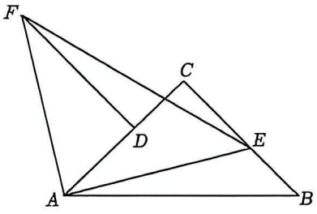
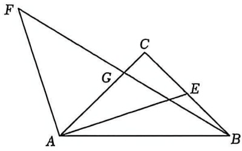

如图，Rt $\triangle ACB$ 中，$\angle ACB = 90^\circ$，$AC = BC$，$E$ 点为射线 $CB$ 上一动点，连接 $AE$，作 $AF \perp AE$ 且 $AF = AE$。

（1）如图1，过 F 点作 $FD\perp AC$ 交 AC 于 D 点，求证：FD=BC；

（2）如图2，连接 BF 交 AC 于 G 点，若 AG=3，CG=1，求证：E 点为 BC 中点；

（3）当 E 点在射线 CB 上，连接 BF 与直线 AC 交于 G 点，若 BC=4，BE=3，则 $\frac{AG}{CG}=$ ___ 。

（直接写出结果）

图1 

图2 

> [!question]- 点击查看答案与解析
> **【答案】**(1) 证明见解析；(2) 证明见解析；(3) $\frac{5}{3}$
> **【考点】**等腰直角三角形、垂直、全等三角形、相似三角形 [[【初中数学知识点体系-人教版】#14-1 全等三角形及其性质]]
>
> **【解析】**
> (1) 证明：$\because \angle ACB = 90^\circ$，$AF \perp AE$，
> $\therefore \angle FAE = \angle ACB = 90^\circ$，
> $\therefore \angle EAC + \angle FAD = 90^\circ$。
> 又 $\because FD \perp AC$，$\therefore \angle FDA = 90^\circ$，
> $\therefore \angle AFD + \angle FAD = 90^\circ$，
> $\therefore \angle EAC = \angle AFD$。
>
> 在 $\triangle ACE$ 和 $\triangle FDA$ 中：
> $\begin{cases} \angle ACE = \angle FDA = 90^\circ \\ \angle EAC = \angle AFD \\ AE = FA \end{cases}$
> $\therefore \triangle ACE \cong \triangle FDA$（AAS）。
> $\therefore AC = FD$。
> 又 $\because AC = BC$，
> $\therefore FD = BC$。
>
> (2) 证明：$\because AG = 3$，$CG = 1$，
> $\therefore AC = AG + CG = 4$，
> $\therefore BC = AC = 4$。
> 由 (1) 知 $\triangle ACE \cong \triangle FDA$，
> $\therefore CE = AD$，$FD = AC = 4 = BC$。
> $\because FD \perp AC$，$BC \perp AC$，
> $\therefore FD \parallel BC$（垂直于同一直线的两条直线平行）。
> $\therefore \triangle FDG \sim \triangle BCG$（AA 相似），
> $\therefore \frac{DG}{CG} = \frac{FD}{BC} = 1$，
> $\therefore DG = CG$，即 $G$ 是 $CD$ 的中点。
>
> 设 $CE = x$，则 $AD = x$。
> 不论 $D$ 在线段 $AC$ 上还是其延长线上，均有：
> $AG = \frac{AC + AD}{2} = \frac{4 + x}{2}$。
> 由 $AG = 3$：$\frac{4 + x}{2} = 3$，解得 $x = 2$。
> $\therefore CE = 2 = \frac{1}{2}BC$，
> 即 $E$ 是 $BC$ 的中点。
>
> (3) 当 $BC = 4$，$BE = 3$，$E$ 在射线 $CB$ 上时：
> 射线 $CB$ 从 $C$ 出发经过 $B$ 向外延伸。
> $\because BE = 3 < BC = 4$，
> $\therefore E$ 在线段 $BC$ 上，$CE = BC - BE = 4 - 3 = 1$。
>
> 由 (1) 知 $\triangle ACE \cong \triangle FDA$，
> $\therefore AD = CE = 1$，$FD = AC = 4$。
> $\because AD = 1 < AC = 4$，
> $\therefore D$ 在线段 $AC$ 上，$CD = AC - AD = 4 - 1 = 3$。
>
> $\because FD \parallel BC$，
> $\therefore \triangle FDG \sim \triangle BCG$（AA 相似），
> $\therefore \frac{DG}{CG} = \frac{FD}{BC} = \frac{4}{4} = 1$，
> $\therefore DG = CG$，即 $G$ 是 $CD$ 的中点。
> $\therefore CG = \frac{1}{2}CD = \frac{3}{2}$。
>
> $AG = AC - CG = 4 - \frac{3}{2} = \frac{5}{2}$。
>
> $\therefore \frac{AG}{CG} = \frac{\frac{5}{2}}{\frac{3}{2}} = \frac{5}{3}$。
>
> **一般公式：** 设 $CE = x$，
> - 当 $E$ 在线段 $BC$ 上（$x < 4$）：$\frac{AG}{CG} = \frac{4 + x}{4 - x}$
> - 当 $E$ 在 $B$ 外侧（$x > 4$）：$\frac{AG}{CG} = \frac{4 + x}{x - 4}$
>
> 代入 $CE = 1$：$\frac{AG}{CG} = \frac{4 + 1}{4 - 1} = \frac{5}{3}$。
>
> **【易错点】**(2) 中需通过相似三角形证明 $G$ 是 $CD$ 中点；(3) 中需注意 $E$ 的位置（在线段 $BC$ 上还是延长线上）。
