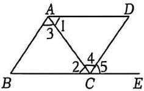

（2分）如图，下列能判定 $AB//CD$ 的条件是( )

A.  $\angle D + \angle BCD = 180^{\circ}$

B.  $\angle 1 = \angle 2$

C.  $\angle B = \angle D$

D.  $\angle B = \angle 5$

> [!question]- 点击查看答案与解析
> **【答案】** D
> **【考点】** [[【初中数学知识点体系-人教版】#7-2 平行线]]
> **【解析】**
> 判定两直线平行的方法有三种：$①$ 同位角相等，两直线平行；$②$ 内错角相等，两直线平行；$③$ 同旁内角互补，两直线平行。
>
> - A. $\angle D + \angle BCD = 180^\circ$：是 AD 与 BC 的同旁内角关系，可判定 $AD \parallel BC$，但与 AB、CD 无关，错误
> - B. $\angle 1 = \angle 2$：根据图形可能是 AD 与 BE 的角关系，错误
> - C. $\angle B = \angle D$：仅两角相等无法判定两直线平行，错误
> - D. $\angle B = \angle 5$：若 $\angle B$ 与 $\angle 5$ 是同位角，可判定 $AB \parallel CD$，正确
>
> **【易错点】** 混淆同位角、内错角和同旁内角；不注意角与直线 AB、CD 的关系。
