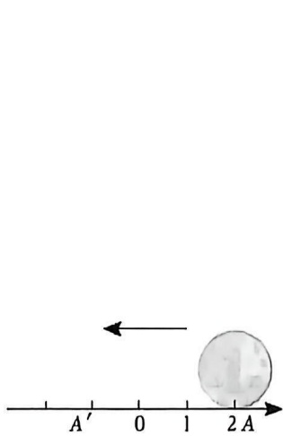

（2分）如图，点 A 是硬币圆周上一点，点 A 与数轴上 2 所对应的数重合，假设硬币的直径为 1 个单位长度，若将硬币按如图所示的方向滚动（无滑动）一周，点 A 恰好与数轴上点 $A'$ 重合，则点 $A'$ 对应的实数是( )

A.  $2 - 2\pi$

B.  $2 + 2\pi$

C.  $2 - \pi$

D.  $2 + \pi$

> [!question]- 点击查看答案与解析
> **【答案】** C
> **【考点】** [[【初中数学知识点体系-人教版】#8-3 实数及其简单运算]]
> **【解析】**
> 硬币的直径 $d=1$ 个单位长度，周长 $C=\pi d=\pi$。
>
> 硬币沿数轴无滑动滚动一周时，圆心移动距离等于周长 $\pi$。点 A 在硬币上从初始位置 2 出发向左移动 $\pi$ 个单位。
>
> 所以 $A'$ 对应的实数为 $2-\pi$。
>
> - A. $2-2\pi$：错把直径当半径
> - B. $2+2\pi$：方向和数值都错
> - C. $2-\pi$：正确
> - D. $2+\pi$：方向错误
>
> **【易错点】** 混淆周长公式 $C=\pi d$ 与 $C=2\pi r$；忽略滚动方向。
