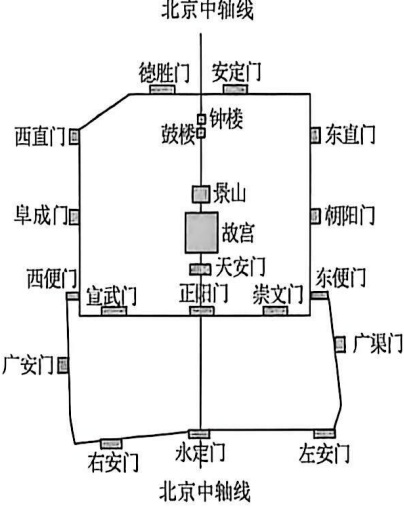

（2分）北京中轴线创建于元代，形成、完善于明清两代，是北京城市建筑东西对称布局的对称轴线。若按图所示，表示东直门的点的坐标为 $(3,4.5)$，表示宣武门的点的坐标为 $(-2,-1)$，则表示下列地点的点的大致坐标正确的是 ( )

A. 正阳门 (0,0)

B. 永定门 (0,-4)

C. 广渠门 (3,-2)

D. 西直门 (-3,4.5)

> [!question]- 点击查看答案与解析
> **【答案】** C
> **【考点】** [[【初中数学知识点体系-人教版】#9-1 用坐标描述平面内点的位置]]
> **【解析】**
> 已知东直门 $(3,4.5)$ 在东北方向，宣武门 $(-2,-1)$ 在西南方向。
>
> - A. 正阳门 $(0,0)$：正阳门在中轴线上，但原点位置未必是它，需对照图
> - B. 永定门 $(0,-4)$：y 坐标数值不准确
> - C. 广渠门 $(3,-2)$：广渠门在东侧，x 坐标与东直门相近（都在 x=3 附近），y 为负（南侧），符合图示，正确
> - D. 西直门 $(-3,4.5)$：西直门应与东直门关于 y 轴对称，x 坐标为 $-3$、y 坐标为 $4.5$，但对照图示位置，该坐标与实际位置不符，错误
>
> **【易错点】** 不能结合实际地理位置判断点的位置。
