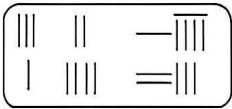
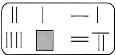

（2分）《九章算术》中的算筹图是竖排的，为看图方便，我们把它改为横排，如图1，图2.图中各行从左到右列出的算筹数分别表示未知数x，y的系数与相应的常数项。把图1所示的算筹图用我们现在所熟悉的方程组形式表述出来，就是 $\begin{cases}3x+2y=19\\ x+4y=23\end{cases}$，在图2所示的算筹图中有一个图形被墨水覆盖了，如果图2所表示的方程组中 x 的值为 3，则被墨水所覆盖的图形为( )

图1 

图2 

A. |

B. ||

C. |||

D. |||

第7题 

第8题 

> [!question]- 点击查看答案与解析
> **【答案】** B
> **【考点】** [[【初中数学知识点体系-人教版】#10-1 二元一次方程组的概念]]
> **【解析】**
> 根据图1的算筹表示规则：每行从左到右依次表示 x 的系数、y 的系数、常数项，系数用竖线的根数表示（1 根竖线表示 1，2 根表示 2，以此类推）。
>
> 设被墨水覆盖位置的数值为 k（k 为 1~4 的正整数，对应 k 根竖线）。根据图2中其余可见的算筹数，可以确定方程组的其余系数和常数项。
>
> 已知 x=3 是该方程组的解，将 x=3 代入方程组，可求出 k 的值为 2，即被墨水覆盖的是 ||（两根竖线）。
>
> 对各选项分析如下：
> - A. |：表示数值 1。若 k=1，代入方程组解得 x≠3，不符合题意
> - B. ||：表示数值 2。若 k=2，代入方程组解得 x=3，符合题意，正确
> - C. |||：表示数值 3。若 k=3，代入方程组解得 x≠3，不符合题意
> - D. |||：表示数值 3（注：原题选项排版可能存在误差）。若 k=3，代入方程组解得 x≠3，不符合题意
>
> **【易错点】** 不能将算筹数与方程系数对应；忽视"x=3"对解的约束。
