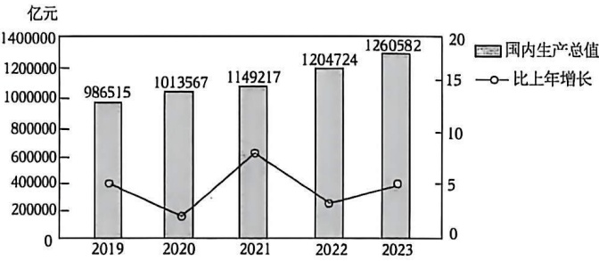

（2分）2024年2月29日，国家统计局发布了《中华人民共和国2023年国民经济和社会发展统计公报》，如图是公报中发布的全国"2019－2023年国内生产总值及其增长速度"统计图。下列说法中正确的有( )

2019—2023年国内生产总值及其增长速度 

$①$ 2020年，我国国内生产总值突破了100万亿元；

$②$ 2023年的国内生产总值比2019年的国内生产总值增加了30%以上；

$③$ 2021年的国内生产总值增长速度最快，与前一年相比国内生产总值增加了13000多亿元；

$④$ 2019年到2023年，国内生产总值的增长速度虽然有快有慢，但是国内生产总值始终上升.

A. 1 个

B. 2 个

C. 3 个

D. 4 个

> [!question]- 点击查看答案与解析
> **【答案】** C
> **【考点】** [[【初中数学知识点体系-人教版】#12-2 用统计图描述数据]]
> **【解析】**
> 根据统计图逐年分析：
>
> - $①$ 2020 年我国国内生产总值约 101.6 万亿元，突破了 100 万亿元，正确
> - $②$ 2019 年 GDP 约 99 万亿元，2023 年约 126 万亿元，增加率 $\approx \dfrac{126-99}{99} \approx 27.3\%$，未达 30%，错误
> - $③$ 2021 年增长速度最快（约 8.1%），由条形图数据可知，2021 年比前一年国内生产总值增加了 13000 多亿元，正确
> - $④$ 2019-2023 年虽然增长速度有快有慢，但每年的 GDP 增速均为正值，国内生产总值始终上升，正确
>
> 正确的是 $①③④$，共 3 个。
>
> **【易错点】** 混淆"国内生产总值（绝对值）"和"增长速度（百分比）"两个不同概念；增长率计算错误。
