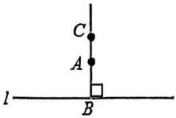

（2分）如图，若$\angle B \perp l$，$BC \perp l$，$B$ 为垂足，那么 $A$、$B$、$C$ 三点在同一直线上，其理由是 ___ 。

> [!question]- 点击查看答案与解析
> **【答案】** 在同一平面内，过一点有且只有一条直线与已知直线垂直（垂线的唯一性）
> **【考点】** [[【初中数学知识点体系-人教版】#7-1 相交线]]
> **【解析】**
> $\angle B \perp l$ 即 $AB \perp l$，$BC \perp l$，两条直线 $AB$ 和 $BC$ 都经过点 B，且都与直线 l 垂直，根据垂线的唯一性（同一平面内，过一点有且只有一条直线与已知直线垂直），A、B、C 三点共线。
>
> **【易错点】** 不能准确叙述垂线唯一性定理。
