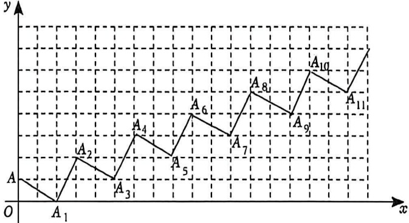

（2分）如图，点 $A(0,1)$，点 $A_{1}(2,0)$，点 $A_{2}(3,2)$，点 $A_{3}(5,1)$，…，按照这样的规律下去，点 $A_{2024}$ 的坐标是 ___.

> [!question]- 点击查看答案与解析
> **【答案】** $(3036, 1013)$
> **【考点】** [[【初中数学知识点体系-人教版】#9-1 用坐标描述平面内点的位置]]
> **【解析】**
> 观察点的坐标：
> - $A_0(0,1)$
> - $A_1(2,0)$
> - $A_2(3,2)$
> - $A_3(5,1)$
> - $A_4(6,3)$
> - $A_5(8,2)$
> - $A_6(9,4)$
>
> 分析每一步的变换：
> - 奇数步（$A_0 \to A_1$，$A_2 \to A_3$，…）：$x+2, y-1$
> - 偶数步（$A_1 \to A_2$，$A_3 \to A_4$，…）：$x+1, y+2$
>
> 每 2 步为一个周期，$x$ 累计增加 $3$，$y$ 回到原值。
>
> 观察偶数下标的点：
> - $A_0 = (0, 1)$
> - $A_2 = (3, 2)$
> - $A_4 = (6, 3)$
> - $A_6 = (9, 4)$
>
> 规律：$A_{2k} = (3k, k+1)$。
>
> $2024 = 2 \times 1012$，所以 $A_{2024} = (3 \times 1012, 1012+1) = (3036, 1013)$。
>
> **【易错点】** 不能正确找到变化规律；周期判断出错。
