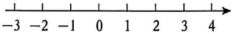

（5分）解不等式 $\frac{x-4}{3}+1>\frac{x-2}{2}$，并将解集表示在数轴上.

> [!question]- 点击查看答案与解析
> **【答案】** $x<4$
> **【考点】** [[【初中数学知识点体系-人教版】#11-2 一元一次不等式]]
> **【解析】**
> 解不等式 $\dfrac{x-4}{3}+1>\dfrac{x-2}{2}$
>
> 去分母（两边同乘 6）：$2(x-4)+6 > 3(x-2)$
>
> 去括号：$2x-8+6 > 3x-6$，即 $2x-2 > 3x-6$
>
> 移项：$2x-3x > -6+2$，即 $-x > -4$
>
> 两边同除以 $-1$（注意不等号方向改变）：$x < 4$
>
> 在数轴上表示：在 4 处画空心圆，从 4 向左延伸。
>
> **【易错点】** 去分母时漏乘常数项；除以负数时忘记改变不等号方向。
