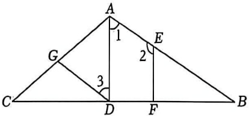

（5分）完成下面的证明.

如图，已知 $AD \perp BC$，$EF \perp BC$，垂足分别为 $D$、$F$，$\angle2 + \angle3 = 180^\circ$。

求证：$\angle GDC = \angle B$

解：∵ $AD \perp BC$，$EF \perp BC$（已知），$\therefore \angle ADB = \angle EFB = 90^\circ$ ( ___ ).

 $\therefore EF \parallel AD(\_\_\_\_\_\_).$

 $\therefore \underline{\hspace{2cm}} + \angle2 = 180^{\circ}$ ( ___ ) .

又 ∵ $\angle2+\angle3=180^{\circ}$（已知），$\therefore \angle 1 = \angle 3$ ( ___ ).

 $\therefore AB//\_\_$ ( ___ ).

 $\therefore \angle GDC = \angle B$ ( ___ ).

> [!question]- 点击查看答案与解析
> **【答案】** 证明过程及填空内容如下
> **【考点】** [[【初中数学知识点体系-人教版】#7-2 平行线]]
> **【解析】**
> 完整证明：
>
> ∵ $AD \perp BC$，$EF \perp BC$（已知）
>
> ∴ $\angle ADB = \angle EFB = 90^\circ$（**垂直的定义**）
>
> ∴ $EF \parallel AD$（**同位角相等，两直线平行**）
>
> ∴ $\angle 1 + \angle 2 = 180^\circ$（**两直线平行，同旁内角互补**）
>
> 又 ∵ $\angle 2 + \angle 3 = 180^\circ$（已知）
>
> ∴ $\angle 1 = \angle 3$（**同角的补角相等**）
>
> ∴ $AB \parallel GH$（**内错角相等，两直线平行**）
>
> ∴ $\angle GDC = \angle B$（**两直线平行，同位角相等**）
>
> **【易错点】** 每一步所依据的定理要准确；"同旁内角"与"内错角"不要混淆；填空处需根据图示填入对应角或直线。
