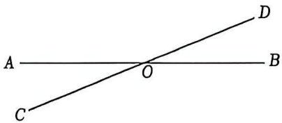

（5分）如图，直线AB，CD 交于点 O，

（1）过点 O 画 CD 的垂线 EF，其中点 E 位于 AB 上方，点 F 位于 AB 下方；

（2）画 $\angle BOE$ 的平分线 OG；

（3）当 $\angle AOC = 20^\circ$ 时，求 $\angle DOG$。

> [!question]- 点击查看答案与解析
> **【答案】** （1）、（2）画图略；（3）$\angle DOG = 55^\circ$
> **【考点】** [[【初中数学知识点体系-人教版】#7-1 相交线]]
> **【解析】**
> （1）用三角板过点 O 作 CD 的垂线 EF，E 在 AB 上方，F 在 AB 下方。
>
> （2）以 O 为顶点，OB 为一边，在 $\angle BOE$ 内部画角平分线 OG。
>
> （3）求 $\angle DOG$：
>
> ∵ $\angle AOC = 20^\circ$（已知）
>
> ∴ $\angle BOC = 180^\circ - 20^\circ = 160^\circ$（邻补角）
>
> ∵ $EF \perp CD$，∴ $\angle COE = 90^\circ$
>
> ∴ $\angle BOE = \angle BOC - \angle COE = 160^\circ - 90^\circ = 70^\circ$
>
> ∵ OG 平分 $\angle BOE$，∴ $\angle BOG = \dfrac{1}{2} \angle BOE = 35^\circ$
>
> ∵ $\angle BOD = \angle AOC = 20^\circ$（对顶角）
>
> ∴ $\angle DOG = \angle BOD + \angle BOG = 20^\circ + 35^\circ = 55^\circ$
>
> **【易错点】** 混淆对顶角与邻补角；不能准确识别 $\angle BOE$ 的大小。
