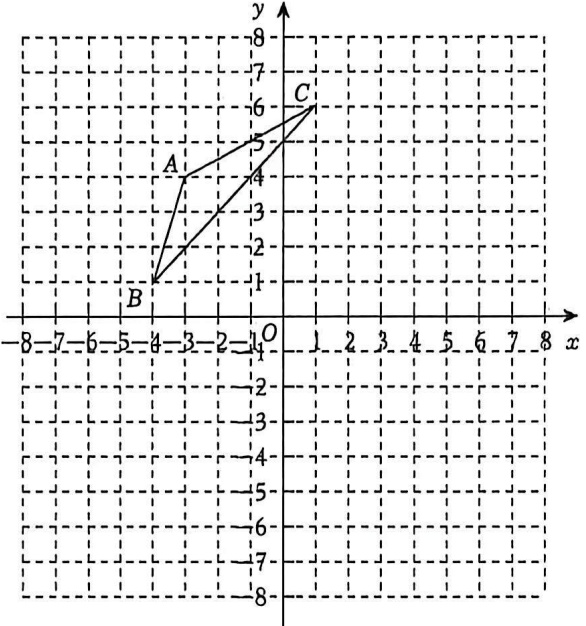

（6分）如图，在平面直角坐标系 xOy 中，已知 $\triangle ABC$ 的三个顶点坐标分别为 $A(-3,4)$，$B(-4,1)$，$C(1,6)$。

（1）在 $\triangle ABC$ 中，点 $C$ 经过平移后的对应点为 $C'(5,3)$，将 $\triangle ABC$ 作同样的平移得到 $\triangle A'B'C'$，画出平移后的 $\triangle A'B'C'$；

（2）将点 $P(2,m)$ 向左平移 5 个单位长度，再向上平移 2 个单位长度得到点 $Q(n,-3)$，则 $m=$ ___ ，$n=$ ___ ；

（3）点 D 是坐标轴上的点，当 $\Delta ABD$ 与 $\Delta ABC$ 的面积相等且点 D 为格点时，直接写出点 D 坐标.

> [!question]- 点击查看答案与解析
> **【答案】** （1）$A'(1,1)$，$B'(0,-2)$，$C'(5,3)$；（2）$m=-5$，$n=-3$；（3）见解析
> **【考点】** [[【初中数学知识点体系-人教版】#9-1 用坐标描述平面内点的位置]]
> **【解析】**
> （1）由 $C(1,6)$ 平移到 $C'(5,3)$，平移向量为 $(5-1, 3-6)=(4,-3)$，即向右平移 4 个单位，再向下平移 3 个单位。
>
> 所以 $A'(-3+4, 4-3)=(1,1)$，$B'(-4+4, 1-3)=(0,-2)$。
>
> 连接 $A'B'$、$B'C'$、$C'A'$ 即得 $\triangle A'B'C'$。
>
> （2）点 $P(2,m)$ 向左平移 5 个单位，再向上平移 2 个单位，得到点 $Q(2-5, m+2)=(-3, m+2)$。
>
> 由 $Q=(-3, m+2)=(n, -3)$，得 $n=-3$，$m+2=-3$，所以 $m=-5$。
>
> （3）△ABD 与 △ABC 面积相等，说明点 D 到直线 AB 的距离等于点 C 到直线 AB 的距离。点 D 在坐标轴上且为格点，符合条件的点 D 坐标为 $(-1, 0)$、$(0, 3)$、$(0, 23)$（写出所有满足条件的坐标即可）。
>
> **【易错点】** 平移方向判断错误；忽略负数移动方向；求格点时遗漏点。
