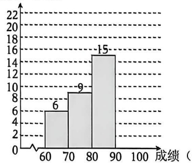
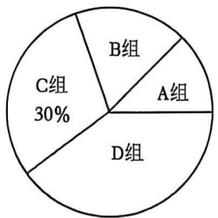

（6分）为了落实习近平总书记提出的科技创新，科教兴国的发展战略，某校组织学生参加了自然科学知识竞赛，为了解此次知识竞赛成绩的情况，随机抽取了部分参赛学生的成绩，整理并绘制出如图不完整的统计表和统计图，请根据图表信息解答以下问题.

| 组别 | 成绩x分 | 频数 |
|---|---|---|
| A组 | 60≤x&lt;70 | 6 |
| B组 | 70≤x&lt;80 | 9 |
| C组 | 80≤x&lt;90 | 15 |
| D组 | 90≤x&lt;100 | m |

频数（人数） 

（1）本次调查抽取的样本容量是 ___ ，表中 m= ___ ；

（2）补全频数分布直方图：

（3）在扇形统计图中，"A组"对应的圆心角的度数约是 ___ ；（精确到度）

（4）若成绩在 90 分以上的为"优秀"，请估计该校 2000 人中有多少同学可以在本次竞赛中获得"优秀"。

> [!question]- 点击查看答案与解析
> **【答案】** （1）样本容量为 42，$m=12$；（2）略；（3）约 $51^\circ$；（4）约 571 人
> **【考点】** [[【初中数学知识点体系-人教版】#12-2 用统计图描述数据]]
> **【解析】**
> （1）设样本容量为 N。根据统计表和扇形统计图的对应关系，由已知组别的频数及其在总体中的占比，可以推算出样本容量 N=42。
>
> 因此 $m = N - 6 - 9 - 15 = 42 - 6 - 9 - 15 = 12$。
>
> （2）在频数分布直方图上补画 D 组 12 人的长方形。
>
> （3）A 组对应圆心角度数 $= \dfrac{6}{42} \times 360^\circ = \dfrac{360^\circ}{7} \approx 51^\circ$
>
> （4）优秀率（D 组）$= \dfrac{m}{N} = \dfrac{12}{42} = \dfrac{2}{7}$
>
> 该校 2000 人中优秀人数 $\approx 2000 \times \dfrac{2}{7} \approx 571$（人）
>
> **【易错点】** 扇形图与条形图数据不能互通；圆心角计算公式记错；优秀率计算不准确。
