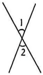
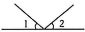
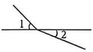
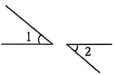

（2分）下列各图中，$\angle1$ 和 $\angle2$ 是对顶角的是（）

A.

B.

C.

D.

> [!question]- 点击查看答案与解析
> **【答案】** C
> 
> **【考点】** 对顶角的定义与识别 → [[【初中数学知识点体系-人教版】#7-1 相交线]]
> 
> **【解析】**
> - 选项A：图中$\angle1$和$\angle2$不是由两条直线相交形成的，不满足对顶角的定义，错误；
> - 选项B：图中$\angle1$和$\angle2$虽然有公共顶点，但不是相对的两个角，而是相邻的角，错误；
> - 选项C：图中$\angle1$和$\angle2$是由两条直线相交形成的，且有公共顶点，两个角相对，符合对顶角的定义，正确；
> - 选项D：图中$\angle1$和$\angle2$不是由两条直线相交形成的对顶关系，错误。
> 
> **【易错点】** 对顶角必须满足两个条件：$①$有公共顶点；$②$两个角相对。容易与邻补角混淆。
