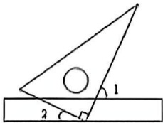

（2分）如图，将三角形的直角顶点放在直尺的一边上，若 $\angle1=65^{\circ}$，则 $\angle2$ 的度数为 ( )

A. $10^{\circ}$

B. $15^{\circ}$

C. $20^{\circ}$

D. $25^{\circ}$

> [!question]- 点击查看答案与解析
> **【答案】** D
> 
> **【考点】** 平行线的性质、直角三角形的性质 → [[【初中数学知识点体系-人教版】#7-2 平行线]]
> 
> **【解析】**
> 如图，三角形的直角顶点放在直尺的一边上，直尺的两边是平行的。
> 设直角三角形的三个角分别为$90^{\circ}$、$\angle1=65^{\circ}$、$\angle3$。
> 由直角三角形两锐角互余，得$\angle3=90^{\circ}-65^{\circ}=25^{\circ}$。
> 因为直尺两边平行，所以$\angle2=\angle3=25^{\circ}$（内错角相等）。
> - 选项A：$10^{\circ}$，计算错误；
> - 选项B：$15^{\circ}$，计算错误；
> - 选项C：$20^{\circ}$，计算错误；
> - 选项D：$25^{\circ}$，正确。
> 
> **【易错点】** 需要利用直角三角形两锐角互余求出另一个锐角，再利用平行线的性质（内错角相等）求出$\angle2$。
