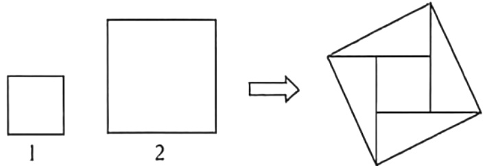

（2分）如图，将边长分别为 1 和 2 的两个正方形剪拼成一个较大的正方形，该大正方形的边长最接近的整数是（）

A. 4

B. 3

C. 2

D. 1

> [!question]- 点击查看答案与解析
> **【答案】** C
> 
> **【考点】** 正方形面积、算术平方根的估算 → [[【初中数学知识点体系-人教版】#8-1 平方根]]
> 
> **【解析】**
> 两个正方形的面积分别为$1^2=1$和$2^2=4$。
> 剪拼后大正方形的面积为$1+4=5$。
> 设大正方形的边长为$a$，则$a^2=5$，$a=\sqrt{5}$。
> 因为$4<5<9$，所以$2<\sqrt{5}<3$。
> 又因为$5$更接近$4$，所以$\sqrt{5}$更接近$2$。
> $\sqrt{5}\approx2.24$，最接近的整数是$2$。
> - 选项A：4，明显过大，错误；
> - 选项B：3，$\sqrt{5}\approx2.24$，不是最接近3，错误；
> - 选项C：2，$\sqrt{5}\approx2.24$，最接近2，正确；
> - 选项D：1，明显过小，错误。
> 
> **【易错点】** 计算大正方形面积时容易遗漏小正方形的面积；估算$\sqrt{5}$时要准确判断其接近哪个整数。
