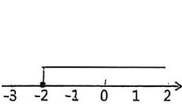

（2分）某个关于 $x$ 的不等式的解集在数轴上的表示如图所示，这个不等式的解集是 ___ .

> [!question]- 点击查看答案与解析
> **【答案】** $x>-1$
> 
> **【考点】** 在数轴上表示不等式的解集 → [[【初中数学知识点体系-人教版】#11-2 一元一次不等式]]
> 
> **【解析】**
> 从图中可以看出，数轴上$-1$处是空心圆圈，且向右延伸（包含大于$-1$的所有数）。
> 所以这个不等式的解集是$x>-1$。
> 
> **【易错点】** 数轴上空心圆圈表示不包含该点（用$>$或$<$），实心圆点表示包含该点（用$\geqslant$或$\leqslant$）。
