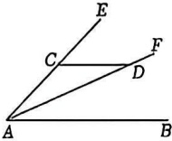

（2分）如图，请你添加一个条件，使 $AB//CD$，这个条件是 ___ .

> [!question]- 点击查看答案与解析
> **【答案】** $\angle1=\angle2$（答案不唯一）
> 
> **【考点】** 平行线的判定 → [[【初中数学知识点体系-人教版】#7-2 平行线]]
> 
> **【解析】**
> 根据平行线的判定定理，可以添加以下条件之一：
> - $\angle1=\angle2$（同位角相等，两直线平行）
> - $\angle3=\angle4$（内错角相等，两直线平行）
> - $\angle1+\angle4=180^{\circ}$（同旁内角互补，两直线平行）
> 答案不唯一，写出其中一个即可。
> 
> **【易错点】** 需要准确识别同位角、内错角、同旁内角的位置关系。
